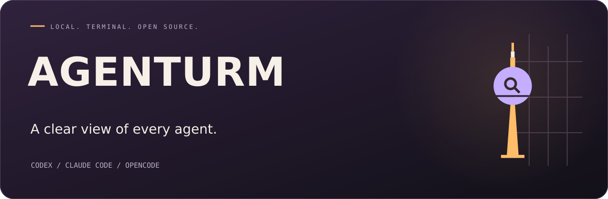
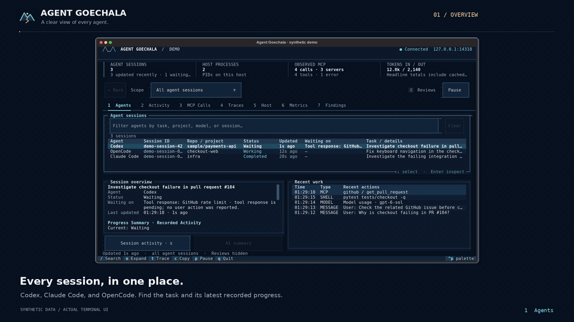

<p align="center">
  
</p>

<h1 align="center">Agent Goechala</h1>

<p align="center">
  <strong>Your agents are working. See what is happening.</strong><br>
  A local terminal monitor for Codex, Claude Code, OpenCode, and OpenTelemetry agents.
</p>

<p align="center">
  <a href="https://github.com/abhishekash/agent-goechala/actions/workflows/ci.yml"></a>
  
  
  <a href="LICENSE"></a>
</p>

<p align="center">
  <a href="#start">Start</a> · <a href="#see-the-work">See the work</a> · <a href="#go-deeper">Go deeper</a> · <a href="docs/usage.md">Documentation</a>
</p>

## See the work

<p align="center">
  <a href="https://github.com/abhishekash/agent-goechala/raw/refs/heads/main/media/goechala-demo.mp4">
    
  </a>
</p>

<p align="center">
  <a href="https://github.com/abhishekash/agent-goechala/raw/refs/heads/main/media/goechala-demo.mp4">Watch the full 1080p video</a> · <a href="docs/investigation-video.md">Transcript and reproduction</a><br>
  <sub>Actual terminal UI. Synthetic example records. No personal prompts or session logs.</sub>
</p>

Several agents, several terminals, and one question: **what has happened so far?**

Goechala brings the sessions together. See which agents are working, what they
last did, and which ones need your attention. Select a session to read its
recorded progress, then follow the prompts, tool calls, and execution details.

## Start

Requires **Python 3.11+**, Git, and [uv](https://docs.astral.sh/uv/getting-started/installation/).
Run the renamed app directly from its source repository:

```bash
uvx --from git+https://github.com/abhishekash/agent-goechala agent-goechala
```

Or install the command once:

```bash
uv tool install --force git+https://github.com/abhishekash/agent-goechala
agent-goechala
```

Open it wherever you work. Supported local Codex, Claude Code, and OpenCode
session records are discovered automatically. **No browser, account, or API key
is needed for local monitoring and recorded-progress summaries.**

Already have the checkout? Run `./scripts/install.sh` on macOS/Linux or
`.\scripts\install.ps1` on Windows, then launch `agent-goechala`.

## One overview. Detail when you need it.

| Start with… | Then inspect… |
| --- | --- |
| **Agents** — sessions, projects, status, last update | A session's goal, recorded progress, current work, and reported waits |
| **Activity** — what happened in the selected session | Your prompts, assistant messages, shell commands, file changes, and errors |
| **MCP calls** — which servers and tools were used | Readable arguments, responses, failures, duration, and the linked execution |
| **Traces** — how a run fits together | Parent/child operations, model usage, and errors |
| **Metrics and host** — resource and usage details | Recorded OTLP metrics and known local processes |

Start agents and answer their requests in their own terminals. Goechala monitors
the evidence they produce; it shows when a session needs a reply without
pretending it can approve on the agent's behalf.

### Keyboard first

| Key | Action |
| --- | --- |
| `1`–`7` | Switch views |
| `↑` / `↓`, `Enter` | Select and inspect a row |
| `/` | Search the current view |
| `e` | Expand the selected details |
| `t` | Follow the linked trace |
| `Esc` / `Alt+←` | Return / navigate back |
| `c` | Copy details |
| `q` | Quit |

In **Activity**, use **Prompts** to read the prompt sequence for the selected
agent. Search, session scope, and selection help keep other sessions out of the
investigation. Compact terminals can expand details with `e`.

## Local by default

Session records and telemetry stay in a local SQLite database. The built-in
receiver listens on `127.0.0.1:14318`. Recognizable credentials are redacted on a
best-effort basis; `--metadata-only` omits native session text, commands, and
outputs. Read the [capture and privacy boundaries](docs/privacy.md) for details.

Recorded-progress summaries work immediately. Optional AI summaries reuse an
existing `OPENAI_API_KEY` when available and run only when requested. Provider
calls send the documented session evidence to that provider; review
[AI summary setup and data](docs/usage.md#optional-ai-summaries) before enabling
them.

## Go deeper

- [Complete usage guide](docs/usage.md)
- [Python integrations and automatic SDK capture](docs/python.md)
- [Pydantic AI, Google ADK, Gemini CLI, and other OTLP agents](docs/frameworks.md)
- [JavaScript client](docs/javascript.md)
- [Receiver and OTLP configuration](docs/receiver.md)
- [Brand assets and Alpine Ember theme](docs/branding.md)

For querying recorded MCP executions conversationally, see
[SpanHound](https://github.com/abhishekash/spanhound), the companion MCP tool.

## Develop

```bash
git clone https://github.com/abhishekash/agent-goechala.git
cd agent-goechala
uv sync
uv run agent-goechala
uv run python -m unittest discover -s tests -v
```

See [CONTRIBUTING.md](CONTRIBUTING.md) for development and demo production.
[Issues](https://github.com/abhishekash/agent-goechala/issues) and small pull
requests with clear reproductions are welcome.

<details>
<summary>Upgrading from Agent Observatory</summary>

Agent Goechala is the new name. Install from this repository to get the new
command. Existing Python imports (`observatory`), `OBSERVATORY_*` settings,
telemetry keys, and `observatory.db` history continue to work. The old command
is also retained as an alias. The renamed PyPI distribution will be available
after its first release; the source install above works independently of that
publication.

</details>

---

**Agent Goechala** is open source under the [MIT license](LICENSE).
The pass mark and the terminal's Alpine Ember palette are included in the same repository.
