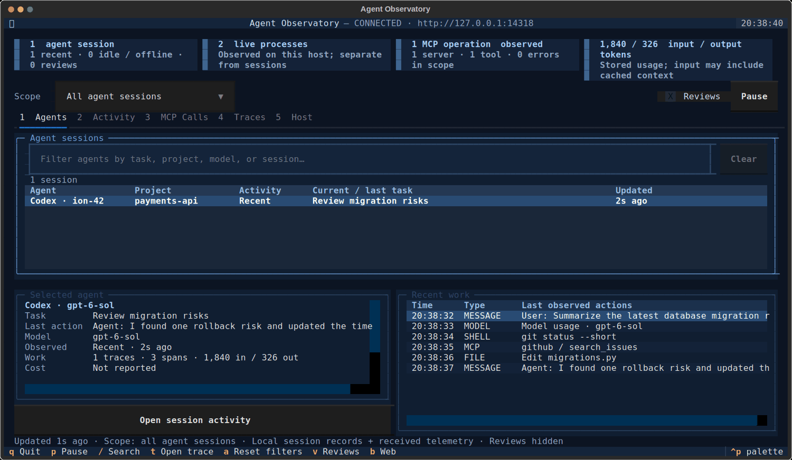

# Agent Observatory

[](https://github.com/abhishekash/agent-observatory/actions/workflows/ci.yml)


**See what your agents are doing, live.** Agent Observatory watches local Codex and Claude Code sessions, receives OpenTelemetry from instrumented agents, and brings tasks, tool calls, MCP, traces, tokens, errors, and host activity into one terminal cockpit and local web dashboard.

<p align="center">
  
</p>

<p align="center"><em>Short demo using synthetic example data. No real session logs or user prompts are included.</em></p>

## Start in one command

Requires Python 3.11+. Install [uv](https://docs.astral.sh/uv/getting-started/installation/) if needed, then:

```bash
uv tool install 'git+https://github.com/abhishekash/agent-observatory'
agent-observatory
```

This repository is private, so GitHub authentication and repository access are required for the Git install.

The terminal cockpit discovers recent local Codex and Claude Code sessions automatically. Press **b** to open the local web dashboard. It listens on `127.0.0.1:14318`.

Already cloned the repository? Run the installer for your shell:

```bash
./scripts/install.sh
```

```powershell
.\scripts\install.ps1
```

These install the checkout as an isolated uv tool. Re-run the script after pulling an update. No administrator access is needed.

## What you get

- **Agents:** distinct sessions, project, current task, model, recent actions, and activity state.
- **Activity:** readable user/assistant messages, shell commands, file changes, browser events, model use, and tool results.
- **MCP:** server and tool calls with readable arguments and results, an Errors filter, latency, and direct links to the execution span.
- **Traces:** parent/child spans, model usage, errors, and evidence for each operation.
- **Host:** known local agent processes and basic resource use, shown separately from sessions.
- **Web dashboard:** searchable live activity with the same local receiver.

The cockpit adapts from compact terminals to wide workspaces. Search stays with each view, **Enter** inspects a row, **e** expands the details, and **Esc** returns to the list.

The receiver stores data in a local SQLite file. Native session capture is bounded and redacts recognizable credentials on a best-effort basis. Choose metadata-only capture with `--metadata-only`. See [Privacy and capture boundaries](docs/privacy.md).

## Connect other agents

Send OpenTelemetry traces, logs, and metrics over OTLP/HTTP, or use the Python and JavaScript clients:

- [Python setup and automatic SDK capture](docs/python.md)
- [Node.js client](docs/javascript.md)
- [OTLP, receiver, and deployment configuration](docs/receiver.md)
- [Complete usage guide and examples](docs/usage.md)

## Develop

```bash
git clone https://github.com/abhishekash/agent-observatory.git
cd agent-observatory
uv tool install --editable .
python -m unittest discover -s tests -v
```

Contributions and bug reports are welcome. See [CONTRIBUTING.md](CONTRIBUTING.md) and [open an issue](https://github.com/abhishekash/agent-observatory/issues).
